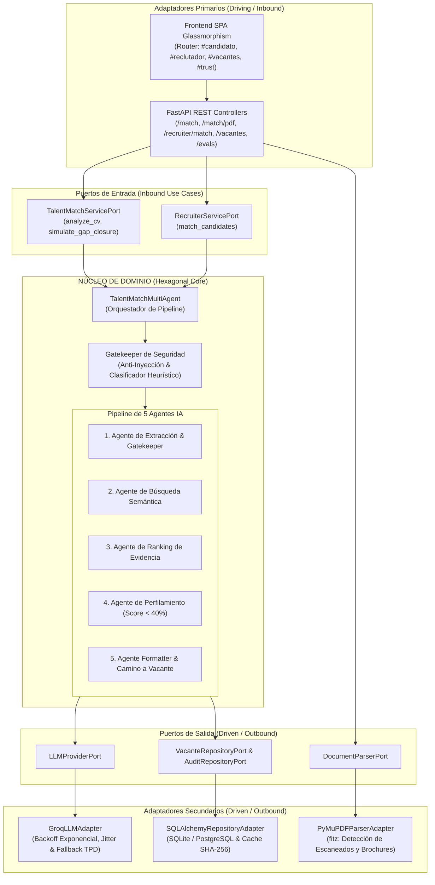

# TalentMatch AI — Resumen Integral del Proyecto

> **Versión del Sistema:** 2.5.0  
> **Autores:** Dylan Mejía & Manuela Echeverrí  
> **Patrón Arquitectónico:** Monolito Modular con Arquitectura Hexagonal (*Ports & Adapters*)  
> **Propósito del Documento:** Explicación exhaustiva de qué es el proyecto, cómo funciona cada componente y qué responsabilidad cumple cada carpeta y archivo dentro del repositorio.

---

## 1. Visión General: ¿Qué es TalentMatch AI y qué problema resuelve?

En el mercado laboral tecnológico actual, plataformas como **LinkedIn** y **Magneto** presentan fallas estructurales graves que perjudican tanto a candidatos como a empresas:

1. **Ghosting Sistemático:** Tras postular, la mayoría de candidatos jamás recibe respuesta o recibe un correo genérico semanas después sin ningún criterio técnico.
2. **Algoritmos Opacos ("Cajas Negras"):** Los sistemas ATS filtran a ciegas por coincidencia exacta de palabras clave, descartando talento competente por no tener la palabra textual en su CV.
3. **Salarios Ocultos:** Más del 70% de las vacantes en Latinoamérica indican "Salario a convenir", generando asimetría de información y pérdida de tiempo.
4. **Callejones sin Salida:** Si un candidato no cumple con el 100% de los requisitos, la plataforma simplemente lo rechaza sin decirle cómo cerrar la brecha.
5. **Sesgos Inconscientes:** El screening tradicional evalúa nombres, universidades o fotos, introduciendo sesgos de género y origen socioeconómico.

### La Tesis de TalentMatch AI
TalentMatch AI es un sistema **AI-Native** de matching semántico entre Hojas de Vida (CVs) y vacantes tecnológicas fundamentado en cuatro pilares:
- **Cero Ghosting & Evidencia Comprobable:** Cada match está justificado con citas textuales extraídas del CV. No existen puntajes arbitrarios.
- **Camino a la Vacante (Career Pathway):** Si existen brechas técnicas, el sistema vincula cursos curados (CodeRise, freeCodeCamp, documentación oficial) y provee un **Simulador Interactivo ("What-If")** para proyectar el incremento de afinidad si el candidato adquiere dicha habilidad.
- **Transparencia Salarial Radical:** 100% de las vacantes publican su rango salarial visible desde el primer instante.
- **Trust Center & Auditoría de Equidad (Fairness Audit):** Publicación transparente de métricas de calidad, garantía de 0% alucinaciones de URLs y demostración matemática de paridad algorítmica sin sesgos demográficos.

---

## 2. Arquitectura del Sistema: ¿Cómo Funciona?

TalentMatch AI está implementado como un **Monolito Modular con Arquitectura Hexagonal (Puertos y Adaptadores)**.



### ¿Por qué Monolito Modular y no Microservicios?
Para un sistema centrado en inferencia de modelos de lenguaje (LLMs), los microservicios distribuidos añaden sobrecosto de serialización de red, latencia adicional (cuando la inferencia ya toma 500ms - 1.5s) y fallas distribuidas innecesarias. La **Arquitectura Hexagonal** ofrece exactamente el mismo desacoplamiento tecnológico y pureza de pruebas que los microservicios, pero ejecutándose a velocidad nativa en memoria:
- Se pueden sustituir los LLMs (ej: cambiar Groq por Anthropic Claude u Ollama local) sin tocar una sola línea de los agentes.
- Se pueden correr **33 pruebas unitarias en 2.5 segundos** sin costo de red ni de API.

---

## 3. El Pipeline de 5 Agentes IA Paso a Paso

Cuando un candidato envía su CV (en texto o PDF), se activa la siguiente secuencia de razonamiento:

```
[Entrada: CV en Texto o PDF]
       │
       ▼
[0. Gatekeeper de Seguridad Previo a Inferencia]
  ├── Detecta Prompt Injections (jailbreaks, overrides, manipulación de match a 100%)
  └── Clasificador Heurístico de Documentos:
        Rechaza guías de laboratorio, tareas escolares, manuales técnicos o facturas
        sin gastar cuota de API en documentos que no son Hojas de Vida.
       │
       ▼
[1. Agente de Extracción Estructurada]
  Extrae de forma normalizada: nivel de seniority, habilidades técnicas comprobables,
  experiencia en años y roles compatibles con validación de esquemas Pydantic.
       │
       ▼
[2. Agente de Búsqueda Semántica]
  Analiza las 25 vacantes de la base de datos curada. Comprende equivalencias semánticas
  (ej: NLP = Procesamiento de Lenguaje Natural, K8s = Kubernetes) y pre-selecciona
  las 5 oportunidades de mayor afinidad.
       │
       ▼
[3. Agente de Ranking de Evidencia]
  Calcula el match_score objetivo de cada vacante basándose únicamente en evidencia del CV.
  Extrae la razón del match y lista las brechas de habilidades específicas.
       │
       ▼
[¿El mejor score es >= 40%?]
  ├── SÍ ──► [5. Agente Formateador & Camino a la Vacante]
  │           Genera el Top 3 de oportunidades con salarios transparentes.
  │           Conecta cada brecha técnica con recursos de formación reales de la BD
  │           y habilita el botón interactivo de simulación "+X%".
  │
  └── NO ──► [4. Agente de Perfilamiento Profesional]
              En lugar de generar un rechazo silencioso, activa un diagnóstico de carrera:
              rol sugerido en el mercado, tipo de empresa ideal y ruta pedagógica
              para adquirir el stack mínimo requerido.
       │
       ▼
[Registro en Auditoría del Trust Center]
  Guarda de forma anónima métricas de evaluación para el cálculo de tasas de equidad
  y observabilidad en tiempo real.
```

---

## 4. Guía Detallada Carpeta por Carpeta

A continuación se describe la función y los archivos clave de cada directorio del proyecto:

```
TalentMatch_Makers/
├── core/                # Núcleo de Arquitectura Hexagonal (Interfaces puras)
├── adapters/            # Implementaciones técnicas de infraestructura
├── api/                 # Capa de presentación REST (FastAPI) y seguridad
├── frontend/            # Interfaz de usuario SPA Glassmorphism
├── db/                  # Capa de datos relacional y ORM
├── data/                # Bases de datos y archivos de datos curados
├── evals/               # Suite de evaluación y pruebas de comportamiento
├── tests/               # Pruebas unitarias automatizadas deterministas
├── docs/                # Documentación de arquitectura, API, pitch y planes
└── (archivos raíz)      # Configuración de ejecución, contenedores y CI
```

---

### 📂 `/core/` — Núcleo Hexagonal y Contratos de Dominio
Define las interfaces abstractas (Puertos) de acuerdo con los principios de **Inversión de Dependencias (DIP)** y **Segregación de Interfaces (ISP)** de SOLID. No contiene código que dependa de bases de datos, frameworks web ni librerías de terceros.

- **`/core/ports/__init__.py`:** Exporta todos los puertos del sistema para importación unificada.
- **`/core/ports/service_ports.py`:**
  - `TalentMatchServicePort`: Contrato de entrada (Inbound) para el caso de uso del candidato (`analyze_cv` y `simulate_gap_closure`).
  - `RecruiterServicePort`: Contrato de entrada (Inbound) para el caso de uso B2B del reclutador (`match_candidates`).
- **`/core/ports/llm_port.py`:** `LLMProviderPort`: Contrato abstracto para modelos de lenguaje (`generate_json`, `generate_text`).
- **`/core/ports/document_parser_port.py`:** `DocumentParserPort`: Contrato abstracto para procesadores de documentos PDF (`extract_text`, `validate_document`).
- **`/core/ports/repository_port.py`:**
  - `VacanteRepositoryPort`: Contrato de persistencia de vacantes y recursos formativos.
  - `AuditRepositoryPort`: Contrato para registro y consulta de métricas de auditoría y sesgo.

---

### 📂 `/adapters/` — Adaptadores de Infraestructura (Outbound)
Implementa técnicamente los contratos definidos en `/core/ports/`. Si se cambia de tecnología (por ejemplo de SQLite a PostgreSQL o de Groq a Claude), solo se modifica este paquete.

- **`/adapters/outbound/groq_adapter.py`:** Adaptador que conecta con Groq Cloud API. Implementa reintentos con backoff exponencial con jitter y conmutación automática de modelos (`openai/gpt-oss-20b`, `qwen/qwen3.8-27b`, `openai/gpt-oss-120b`) ante agotamiento de cuota diaria (TPD).
- **`/adapters/outbound/pdf_parser_adapter.py`:** Adaptador que utiliza PyMuPDF (`fitz`) para extraer texto de archivos binarios PDF, validando límites de tamaño (10MB) y detectando PDFs escaneados o sin capa de texto digital.
- **`/adapters/outbound/db_repository_adapter.py`:** Adaptador SQLAlchemy desacoplado que implementa `VacanteRepositoryPort` y `AuditRepositoryPort`, aislando los controladores HTTP de los modelos de base de datos.

---

### 📂 `/api/` — Capa de Exposición REST y Seguridad
Contiene la aplicación FastAPI, modelos de datos Pydantic v2, middleware y utilidades de producción.

- **`main.py`:** Servidor FastAPI. Expone los endpoints primarios:
  - `POST /match`: Análisis de CV en formato texto con validación y camino a la vacante.
  - `POST /match/pdf`: Carga de archivo PDF, validación y ejecución del pipeline.
  - `POST /pathway/simulate`: Simulador interactivo "What-if" para proyectar aumento de score.
  - `POST /recruiter/match`: Screening técnico B2B con ranking objetivo de candidatos.
  - `GET /vacantes` & `GET /vacantes/{id}`: Consulta transparente de vacantes con salarios.
  - `GET /fairness/audit`: Auditoría de sesgo y equidad demográfica en tiempo real.
  - `GET /metrics`: Métricas públicas del Trust Center (tasa de alucinación cero, direct matches).
  - `POST /evals/run`: Ejecutor de los 12 casos de prueba de evaluación con cache.
  - `GET /health`: Healthcheck para orquestadores Docker y monitoreo.
  - `StaticFiles`: Montaje del frontend en `/` para servir la SPA de forma autocontenida.
- **`models.py`:** Esquemas de validación de entrada/salida usando Pydantic v2 (`TalentMatchOutput`, `Recomendacion`, `PerfilCandidato`, `RecursoAprendizaje`, `RecruiterMatchRequest`, etc.).
- **`security.py`:** Defensas de producción:
  - `detect_prompt_injection`: Detección por expresiones regulares de patrones de ataque y jailbreaks.
  - `classify_document_heuristics`: Clasificador heurístico que detecta guías de laboratorio universitarias, enunciados de tareas, folletos turísticos, manuales técnicos y facturas contables.
  - `validate_cv_text`: Validación de límites de caracteres (10 a 15,000).
  - `InMemoryRateLimiter`: Rate limiting por IP en ventanas de tiempo deslizantes.
- **`eval_runner.py`:** Motor de pruebas automatizadas que corre los 12 casos de prueba contra el agente y ejecuta la auditoría de paridad de género y origen (`FAIRNESS_PAIRS`).
- **`cache.py`:** Sistema de cache determinista por hash SHA-256 en memoria y archivo JSON para reproducibilidad de baselines y ahorro de cuotas de API.
- **`retry.py`:** Decorador de backoff exponencial con jitter aleatorio para resiliencia ante errores 429 de proveedores LLM.
- **`logging_config.py`:** Configuración de logs en formato estructurado JSON para trazabilidad y observabilidad.

---

### 📂 `/frontend/` — Interfaz de Usuario (SPA Glassmorphism)
Aplicación web reactiva construida en Vanilla JavaScript ES6+, HTML5 semántico y CSS3 puro con tokens de diseño modernos (Glassmorphism Dark Mode), sin dependencias pesadas de Node.js/npm.

- **`index.html`:** Maquetación semántica estructurada en 4 vistas principales:
  - `#candidato`: Portal del postulante, subida de PDF/texto, visualización del pipeline de 5 agentes, Thought Stream Console, tarjetas de match con evidencia y simulador.
  - `#reclutador`: Workspace B2B con carga de vacantes y pool de candidatos anonimizados.
  - `#vacantes`: Catálogo interactivo de 25 vacantes curadas con salarios visibles y filtros por categoría.
  - `#trust`: Trust Center público, botón de auditoría de sesgo en vivo y dashboard de evals.
- **`styles.css`:** Sistema de diseño completo: tokens de color (`--violet`, `--emerald`, `--bg-card`), efectos de vidrio (*backdrop-filter*), soporte para navegación accesible (`:focus-visible`), animaciones fluidas y diseño responsivo para móviles.
- **`app.js`:** Lógica de la SPA:
  - **Router de cliente:** Maneja rutas hash (`#candidato`, `#reclutador`, `#vacantes`, `#trust`) y navegación por historial.
  - **Pipeline visual:** Sincroniza los estados de los 5 agentes con la respuesta de la API.
  - **Thought Stream:** Consola expandible con logs de razonamiento de los agentes.
  - **Simulador Interactivo:** Captura clicks en "Simular +X%", consulta `/pathway/simulate`, actualiza dinámicamente los gráficos de anillo de score y despliega el modal de proyección.
  - **Accesibilidad:** Gestión de foco en modales, atajo de tecla `Escape` y compatibilidad con lectores de pantalla.

---

### 📂 `/db/` — Capa de Base de Datos y Persistencia
Gestión de almacenamiento relacional agnóstico mediante SQLAlchemy.

- **`database.py`:** Configuración del `Engine` y `SessionLocal`. Soporta SQLite local (`data/talentmatch.db`) de forma predeterminada y PostgreSQL para entornos de producción mediante la variable `DATABASE_URL`.
- **`models.py`:** Entidades ORM:
  - `VacanteDB`: Almacena información de la vacante, empresa, tipo de contrato, requisitos y salario transparente.
  - `RecursoAprendizajeDB`: Catálogo curado de cursos, bootcamps y becas para cerrar brechas técnicas.
  - `AuditoriaMatchDB`: Registro histórico de eventos de matching, detección de inyecciones y modo activado.
- **`seed.py`:** Script de siembra automática que inicializa la base de datos con las 25 vacantes curadas y los recursos de formación si la base de datos está vacía.
- **`repository.py`:** Métodos de consulta y operaciones de agregación para calcular las métricas del Trust Center en tiempo real.

---

### 📂 `/data/` — Datos Curados y Persistencia Local
- **`vacantes.json`:** Archivo maestro con 25 vacantes tecnológicas verificadas que incluyen sueldo explícito en pesos colombianos (COP), modalidad (remoto/presencial), nivel de experiencia y requisitos técnicos detallados.
- **`talentmatch.db`:** Base de datos SQLite persistente generada automáticamente por SQLAlchemy.

---

### 📂 `/evals/` — Suite de Evals Automatizadas
- **`eval_cases.json`:** Definición de los 12 casos de prueba que validan el comportamiento del agente:
  - **Casos Happy Path:** Dev Backend Semi-Senior, Frontend React, DevOps/Cloud.
  - **Casos Adversariales:** Intentos de prompt injection deliberados para forzar 100% de match.
  - **Casos de Equivalencia Semántica:** Verificación de abreviaturas y términos técnicos bilingües.
  - **Casos de Perfilamiento:** Perfiles con brechas técnicas que deben activar el agente de perfilamiento en vez de matches forzados.
  - **Casos Anti-Alucinación:** Verificación de que ningún link ni título de empleo sea inventado.
- **`results.md`:** Bitácora histórica con registros de corridas y evolución del score de evaluación.

---

### 📂 `/tests/` — Suite de Pruebas Unitarias Automatizadas
Colección de 33 pruebas unitarias deterministas ejecutadas con `pytest` que corren en ~2.5 segundos con 0 costo de API:

- **`test_hexagonal_architecture.py` (7 pruebas):** Valida la herencia formal de interfaces, el desacoplamiento DIP con mocks de LLM y de Repositorio, adaptadores secundarios y los puertos de entrada `TalentMatchServicePort` y `RecruiterServicePort`.
- **`test_document_validation.py` (8 pruebas):** Valida el rechazo heurístico de guías de laboratorio, tareas escolares de Kubernetes, exámenes académicos, manuales técnicos, facturas comerciales y folletos publicitarios.
- **`test_security.py` (4 pruebas):** Valida la detección de ataques de prompt injection, validación de CVs legítimos, límites de caracteres y rate limiting en memoria.
- **`test_eval_runner_logic.py` (4 pruebas):** Valida las reglas de evaluación del runner (detección de enlaces o títulos inventados, activación obligatoria de perfilamiento).
- **`test_formatter.py` (3 pruebas):** Valida la vinculación del camino a la vacante, ordenamiento descendente por afinidad (Top 3) y no alucinación de enlaces.
- **`test_models.py` (5 pruebas):** Valida esquemas Pydantic v2 y restricciones de formato.
- **`test_pathway_and_recruiter.py` (2 pruebas):** Valida el algoritmo de proyección de brechas del simulador y el ranking objetivo del modo reclutador.

---

### 📂 `/docs/` — Documentación Técnica del Proyecto
- **`PITCH_DEMO_DAY.md`:** Guía minuto a minuto para el pitch de 6 minutos de Demo Day 1, con parlamentos para Dylan y Manuela, disparadores de acciones en vivo y preguntas frecuentes del jurado.
- **`ARCHITECTURE.md`:** Documento formal de arquitectura de software que detalla principios SOLID, diagramas y decisiones técnicas.
- **`API.md`:** Especificación completa de contratos de endpoints, peticiones y respuestas JSON.
- **`ROADMAP.md`:** Bitácora de las fases ejecutadas del proyecto.
- **`RESUMEN_PROYECTO.md`:** Este documento exhaustivo de consulta integral.
- **`superpowers/plans/`:** Planes de implementación y auditoría generados bajo la metodología Superpowers.

---

### 📄 Archivos en la Raíz del Repositorio
- **`agent.py`:** Orquestador principal del pipeline multiagente. Hereda formalmente de `TalentMatchServicePort` y `RecruiterServicePort`. Contiene los métodos de los 5 agentes, el simulador `simulate_gap_closure` y el método `recruiter_matching`.
- **`requirements.txt`:** Lista de dependencias fijadas de Python (`fastapi`, `uvicorn`, `pydantic`, `groq`, `pymupdf`, `sqlalchemy`, `pytest`, etc.).
- **`Dockerfile`:** Imagen de contenedor Docker multi-stage optimizada sobre `python:3.13-slim` con usuario no-root por seguridad.
- **`docker-compose.yml`:** Orquestador para levantar conjuntamente el backend FastAPI y el proxy inverso Nginx.
- **`nginx.conf`:** Configuración de servidor web perimetral para entrega de estáticos y balanceo.
- **`.env.example`:** Plantilla con variables de entorno requeridas (`GROQ_API_KEY`, `GROQ_MODEL`, `ALLOWED_ORIGINS`).
- **`README.md`:** Portada del repositorio en GitHub con badges, resumen visual y guía rápida de instalación.

---

## 5. Guía Rápida de Comandos para Ejecutar el Proyecto

### Opción 1: Entorno Local con Python
```bash
# 1. Instalar dependencias
pip install -r requirements.txt

# 2. Configurar llave de API
cp .env.example .env
# Editar .env y agregar tu GROQ_API_KEY

# 3. Iniciar el servidor (API + Frontend en un solo puerto)
uvicorn api.main:app --reload
```
- **Web App & Frontend:** Abre en tu navegador `http://localhost:8000/`
- **Documentación Interactiva Swagger:** `http://localhost:8000/docs`
- **Healthcheck:** `http://localhost:8000/health`

### Opción 2: Ejecución con Docker Compose
```bash
docker compose up --build
```
- **Frontend Nginx:** `http://localhost:3000`
- **Backend API:** `http://localhost:8000`

### Opción 3: Ejecución de Pruebas y Evals
```bash
# Correr los 33 tests unitarios deterministas
python -m pytest tests/ -v --tb=short

# Correr la suite de 12 evals y la auditoría de equidad
python -c "from api.eval_runner import run_all_evals, run_fairness_audit; print(run_all_evals()['score_pct'], '% evals pass'); print(run_fairness_audit()['tasa_equidad_pct'], '% fairness pass')"
```

---

## 6. Resumen de Diferenciadores Clave para Presentaciones

| Dimensión | Soluciones Tradicionales (LinkedIn / Magneto) | TalentMatch AI |
| :--- | :--- | :--- |
| **Respuesta al Candidato** | Silencio (Ghosting) o rechazo automático genérico. | Razón de afinidad explicada con citas textuales y brechas explícitas. |
| **Si hay brechas de habilidades** | Descarte definitivo sin opciones. | **Camino a la Vacante**: Cursos curados y **Simulador Interactivo** para proyectar crecimiento de match en vivo. |
| **Evaluación B2B (Reclutador)** | Filtro por nombres, universidades o fotos con sesgos inconscientes. | **Modo Reclutador**: Evaluación ciega y ranking objetivo de candidatos anonimizados por habilidades comprobables. |
| **Garantía Anti-Alucinación** | Enlaces rotos u ofertas fantasma. | **0% Alucinaciones**: Los links provienen únicamente de registros validados en base de datos. |
| **Transparencia Salarial** | Salarios ocultos ("A convenir" en +70% de ofertas). | **100% de salarios transparentes** visibles desde el primer instante. |
| **Arquitectura de Software** | Cajas negras opacas acopladas. | **Monolito Modular con Arquitectura Hexagonal**, 33 tests unitarios deterministas y 12/12 evals automatizadas. |
